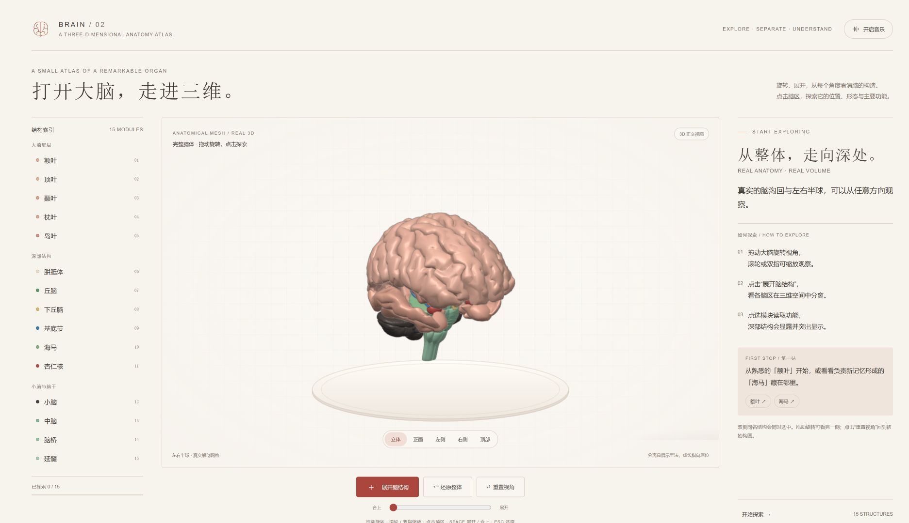
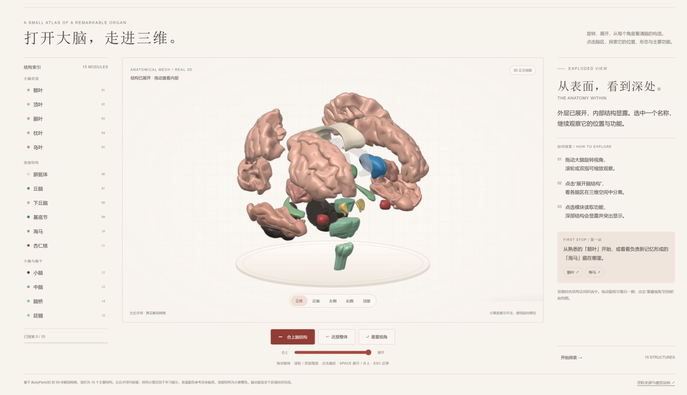

# Brain Atlas 3D · 三维大脑学习图谱

一个可以旋转、展开、合上的交互式大脑模型，帮助学习大脑的构成、中文名称、位置和主要功能。网页采用原生 WebGL，HTML、CSS、JavaScript、模型数据与合成背景音乐全部内联，下载后可离线使用。



## 使用

下载本仓库，直接用新版 Chrome、Edge、Firefox 或 Safari 打开根目录的 **`index.html`**，无需安装依赖。浏览器需要支持 WebGL 和 `DecompressionStream`。

也可以使用 Python 启动本地静态服务：

```bash
python -m http.server 8000
```

然后访问 `http://localhost:8000`。

- 拖动模型旋转，滚轮或双指缩放。
- 点击左侧结构索引或模型中的脑区，使该模块从整体中分离，阅读名称、位置、主要功能与生活示例。
- 点击「展开脑结构 / 合上脑结构」查看整体分解与重组，滑杆可手动控制展开程度。
- 空格展开 / 合上，`Esc` 还原，左右方向键切换模块。
- 点击「开启音乐」播放网页内合成的背景音乐；再次点击即可暂停。

## 学习内容

| 分组 | 模块 |
| --- | --- |
| 大脑皮层 | 额叶、顶叶、颞叶、枕叶、岛叶 |
| 深部结构 | 胼胝体、丘脑、下丘脑、基底节、海马、杏仁核 |
| 小脑与脑干 | 小脑、中脑、脑桥、延髓 |

左右半球均保留。最新网页配色参考实体教具：大脑为肉粉色，小脑为深灰褐色，脑干为薄荷绿，搭配暖白底座。深部结构采用示意着色，帮助识别模块。



## 演示与模型

- [18 秒中文脑区标注视频，含背景音乐](media/brain-atlas-3d-labeled-18s.mp4)
- [15 秒合上—展开—合上视频，含背景音乐](media/brain-atlas-3d-15s.mp4)
- [可编辑 Blender 模型](models/brain-atlas-3d.blend)
- [手机布局预览](docs/preview-mobile.png)

视频和 Blender 文件保留先前导出版本的配色；`index.html` 及网页源码为最新实体教具参考配色。

## 网页源码与重建

运行环境为 Python 3.10 或更高版本，仅使用 Python 标准库：

```bash
python source/build_html.py
```

该命令会把页面模板、知识数据、模型数据、材质样式与交互代码重新打包为根目录的 `index.html`，不需要访问网络，也不依赖其他项目文件。

```text
index.html                  离线网页，下载后直接打开
source/
  build_html.py             单文件网页打包脚本
  template.html             页面结构、知识卡片与合成音乐
  viewer.js                 原生 WebGL 渲染与交互
  model-theme.css           实体教具参考配色
  education.json            15 个脑区的中文学习内容
  geometry.json             网格索引、原位坐标与展开偏移
  geometry.gz.b64           压缩的模型几何数据
  anatomy-map.json          解剖结构与原始模型的对应关系
  prepare_blender.py        原始 OBJ 的 Blender 预处理与导出
  meshes/                   BodyParts3D 原始 OBJ 网格
models/                     可编辑的 Blender 模型
media/                      已导出的演示视频
docs/                       网页截图
MODEL-LICENSE.txt           模型来源、署名与许可
```

如需从原始 OBJ 重新生成模型缓冲数据和 Blender 文件，可在安装 Blender 后运行：

```bash
blender --background --python source/prepare_blender.py -- --no-render
python source/build_html.py
```

## 模型来源与许可

**BodyParts3D, © The Database Center for Life Science licensed under CC Attribution 4.0 International.**

- [BodyParts3D 官方模型下载](https://dbarchive.biosciencedbc.jp/en/bodyparts3d/download.html)
- [BodyParts3D 模型许可](https://dbarchive.biosciencedbc.jp/en/bodyparts3d/lic.html)
- [CC BY 4.0](https://creativecommons.org/licenses/by/4.0/)
- 本项目对模型进行了结构组合、坐标归一化、法线重计算、材质着色、展开动画和网页内联打包；详见 [MODEL-LICENSE.txt](MODEL-LICENSE.txt)。

网页内「资料来源与模型说明」提供解剖和功能参考。该图谱用于基础学习，脑功能由多个脑区协同完成。
